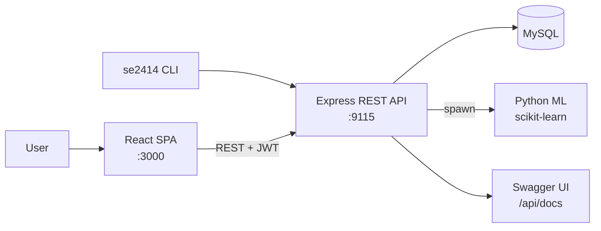

# Toll Interoperability Platform

A full-stack platform for the interoperability of highway toll operators. It tracks vehicle passes across stations of different operators, calculates what operators owe each other and settles those debts, and forecasts traffic with machine learning.

Team project for **Software Engineering 2024–25** at the School of Electrical & Computer Engineering, National Technical University of Athens (NTUA), Team 14.


---

## My role: front-end developer

I designed and built the **React front-end**: 109 of the 113 commits in [`front-end/`](front-end).

- **SPA architecture:** a React 18 app with React Router, a shared header and navigation, and **protected routes** that use JWT stored after login.
- **Interactive map** ([`MapPage`](front-end/src/pages/MapPage.js)): every toll station on a **Leaflet** map, with **marker clustering** and popups that show station details.
- **Statistics dashboard** ([`StatsDashboard`](front-end/src/pages/StatsDashboard.js)): date-range queries against four API endpoints (station passes, pass analysis between operators, pass costs, charges by operator), shown as tables and summaries.
- **Debt settlement** ([`DebtsPage`](front-end/src/pages/DebtsPage.js)): shows the optimized net debts between operators in HTML and CSV views, and has an admin-only action to settle (cancel) debts.
- **Machine-learning forecasts** ([`MachineLearning`](front-end/src/pages/MachineLearning.js)): lets users start model training and request predictions of pass volume and peak hours, plotted with **Recharts** line charts.
- **Authentication UX:** login page with toast notifications and role-aware views (admin vs. regular user).
- **Styling:** custom CSS for each page plus the welcome and landing page.

---

## Features

- **REST API** (Node.js + Express, port `9115`) documented with **OpenAPI / Swagger UI** at `/api/docs`
- **JWT authentication** with role-based access (admin and regular users)
- **CSV upload** of pass data and admin endpoints (health check, resetting stations and passes, user management)
- **Pass analytics:** passes per station, passes between operators, costs and charges for a date range
- **Debt optimization:** net settlement of debts between operators, with generated debt graphs
- **ML forecasting:** Python **scikit-learn** `RandomForestRegressor` models that predict pass volume and peak hours, called from the Node backend
- **CLI client** (`se2414`, Node + Commander) that covers the full API from the terminal
- **Automated tests** for the API with Jest and Supertest

---

## Architecture



---

## Running locally

Requirements: Node.js 18+, MySQL 8 and Python 3 with `pandas` and `scikit-learn` for the ML features.

```bash
# 1. Database
mysql -u root -p < Database_mysql/schema.sql
mysql -u root -p < Database_mysql/data.sql

# 2. Back-end (configure DB credentials in back-end/.env)
cd back-end && npm install && node server.js     # http://localhost:9115

# 3. Front-end
cd front-end && npm install && npm start         # http://localhost:3000
```

---

## Repository layout

```
front-end/        React SPA (pages/, components/, styles/)
back-end/         Express REST API (routers/, controllers/, middlewares/, ml/, testing/)
cli-client/       se2414 command-line client
Database_mysql/   Schema, seed data and helper scripts
documentation/    SRS and UML models (Visual Paradigm)
openapi.json      API specification
```

---

## Team

Built by Team 14 of the NTUA ECE Software Engineering 2024–25 course. See [contributors](../../graphs/contributors) for each member's work.
